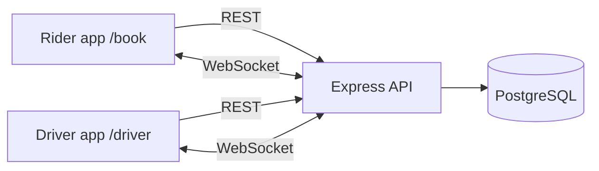

# Vroom 🏍️

Two-wheeler ride booking for the city. Riders book a bike or scooter in minutes; drivers go online, accept rides and earn after a 15% platform fee.

**Live frontend:** https://vroom-lemon.vercel.app/
**Status:** 🚧 Frontend done with mock data. Backend being built one day at a time (see [ROADMAP](./ROADMAP.md)).

## Features

| Feature | Status |
|---|---|
| Landing page, rider booking flow, driver console (mock data) | ✅ |
| Auth (JWT, rider / driver roles) | ⬜ |
| Fare estimate API | ⬜ |
| Ride lifecycle state machine | ⬜ |
| Nearby driver matching | ⬜ |
| Real-time ride status + live location | ⬜ |
| Earnings, ratings, ride history | ⬜ |
| Payments (Razorpay test mode) | ⬜ |
| Docker, CI, deployment | ⬜ |

*(Update this table as each day lands.)*

## Tech stack

- **Frontend:** Next.js 14 (App Router), TypeScript, Tailwind CSS
- **Backend:** Node.js, Express, Prisma, PostgreSQL (Neon)
- **Auth:** JWT + bcrypt
- **Realtime:** Socket.io (planned)
- **Maps:** Leaflet + OpenStreetMap (planned)
- **Payments:** Razorpay test mode (planned)

## Architecture



## Project structure

```
Vroom/
├── app/            # Next.js pages (/, /book, /driver)
├── components/     # UI components
├── lib/            # mock data, API client
├── backend/        # Express + Prisma API
│   ├── prisma/     # schema + migrations
│   └── src/        # routes, middleware, services
├── docs/
│   ├── days/       # one README per day
│   ├── GIT_WORKFLOW.md
│   └── INTERVIEW_QUESTIONS.md
└── ROADMAP.md
```

## Run locally

**Frontend**
```bash
npm install
npm run dev          # http://localhost:3000
```

**Backend**
```bash
cd backend
npm install
cp .env.example .env   # fill DATABASE_URL and JWT_SECRET
npx prisma migrate dev
npm run dev            # http://localhost:4000
```

## Environment variables

| Where | Name | Purpose |
|---|---|---|
| backend | `DATABASE_URL` | Postgres connection string |
| backend | `JWT_SECRET` | signing key for tokens |
| backend | `PORT` | API port (default 4000) |
| frontend | `NEXT_PUBLIC_API_URL` | backend base URL |

## What I learned

See the daily logs in [`docs/days`](./docs/days).